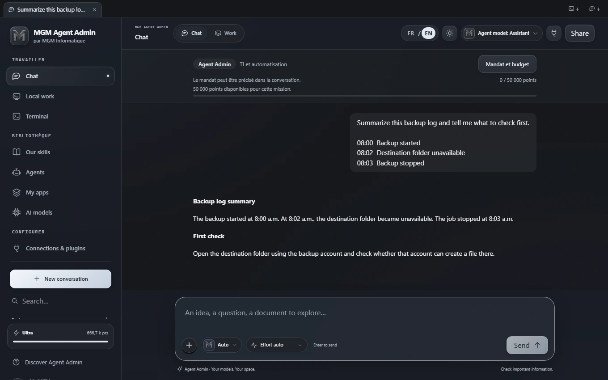

[Français](README.md)

# MGM Informatique

We build web applications, AI agents and automation tools. We also provide IT support for small and midsize businesses and individuals in Montréal, the South Shore and Montérégie, Québec.

[Official website](https://mgminformatique.ca/en/) · [Our applications](https://mgminformatique.ca/en/applications/) · [Tell us about your project](https://mgminformatique.ca/en/contact/)

## Meet MGM Agent Admin

Need to make sense of an error log or check a fix? MGM Agent Admin brings AI chat, project context and work tools together. On Windows, MGM Work also integrates PowerShell into the workspace.

[Open the web app](https://agent-ia.mgminformatique.ca/) · [Windows downloads](https://github.com/mgminformatique/mgm-agent-public/releases/latest) · [MGM Work guide](https://github.com/mgminformatique/mgm-agent-public/blob/main/SHELLAMP.md)

## Our GitHub projects

| Project | What you’ll find |
| --- | --- |
| [MGM Agent Admin](https://github.com/mgminformatique/mgm-agent-public) | Documentation, examples to try and releases for our AI agent. |
| [iPod Photo Recovery](https://github.com/mgminformatique/ipod-photo-recovery) | Python tools to recover and export photos from a legacy iPod photo cache. |
| [MGM Phone Harness](https://github.com/mgminformatique/mgm-phone-harness-ios-kali) | Rust tools for testing a USB-connected iPhone from Kali Linux. |

## Work with MGM

- Automate a repetitive task or explore an agent for your team. [AI agents and automation](https://mgminformatique.ca/en/services/ai-agents-automation/)
- Build a website, online store or internal application. [Websites and applications](https://mgminformatique.ca/en/services/websites-applications/)
- Get help with workstations, networks or collaboration tools. [IT services for businesses](https://mgminformatique.ca/en/services/business-it-services/)

## Get in touch

Have an integration idea, a project question or feedback after trying one of our tools? Join the [GitHub discussions](https://github.com/mgminformatique/mgminformatique.ca/discussions).

For service inquiries or partnerships, use the [contact form](https://mgminformatique.ca/en/contact/) or email [info@mgminformatique.ca](mailto:info@mgminformatique.ca). You can also [follow MGM Informatique on GitHub](https://github.com/mgminformatique).
