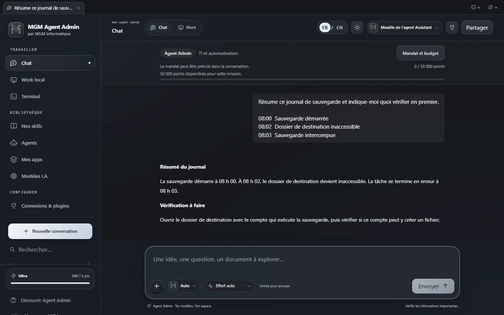

[English](README.en.md)

# MGM Informatique

On développe des applications web, des agents IA et des automatisations. On accompagne aussi les PME et les particuliers pour leurs besoins informatiques à Montréal, sur la Rive-Sud et en Montérégie.

[Site officiel](https://mgminformatique.ca/) · [Nos applications](https://mgminformatique.ca/applications/) · [Parlons de votre projet](https://mgminformatique.ca/contact/)

## Découvrez MGM Agent Admin

Vous avez un journal d’erreurs à comprendre ou une correction à vérifier? MGM Agent Admin réunit la conversation avec un modèle IA, le contexte du projet et les outils pour avancer. Sur Windows, MGM Work intègre aussi PowerShell dans l’espace de travail.

[Ouvrir l’application web](https://agent-ia.mgminformatique.ca/) · [Téléchargements Windows](https://github.com/mgminformatique/mgm-agent-public/releases/latest) · [Guide de MGM Work](https://github.com/mgminformatique/mgm-agent-public/blob/main/SHELLAMP.md)

## Nos projets sur GitHub

| Projet | Ce que vous y trouverez |
| --- | --- |
| [MGM Agent Admin](https://github.com/mgminformatique/mgm-agent-public) | Documentation, exemples à essayer et versions de notre agent IA. |
| [iPod Photo Recovery](https://github.com/mgminformatique/ipod-photo-recovery) | Outils Python pour récupérer et exporter des photos à partir d’un ancien cache iPod. |
| [MGM Phone Harness](https://github.com/mgminformatique/mgm-phone-harness-ios-kali) | Outils Rust pour tester un iPhone connecté en USB depuis Kali Linux. |

## Travailler avec MGM

- Automatisez une tâche répétitive ou explorez un agent adapté à votre équipe. [Agents IA et automatisation](https://mgminformatique.ca/services/agents-ia-automatisation/)
- Créez un site, une boutique en ligne ou une application pour votre équipe. [Sites web et applications](https://mgminformatique.ca/services/sites-web-applications/)
- Obtenez du soutien pour vos postes, vos réseaux ou vos outils de collaboration. [Services TI aux entreprises](https://mgminformatique.ca/services/services-ti-entreprises/)

## Échangeons

Une idée d’intégration, une question sur un projet ou un retour après un essai? Venez en parler dans les [discussions GitHub](https://github.com/mgminformatique/mgminformatique.ca/discussions).

Pour une demande de service ou un partenariat, utilisez le [formulaire de contact](https://mgminformatique.ca/contact/) ou écrivez à [info@mgminformatique.ca](mailto:info@mgminformatique.ca). Vous pouvez aussi [suivre MGM Informatique sur GitHub](https://github.com/mgminformatique).
